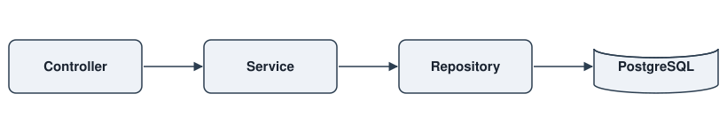
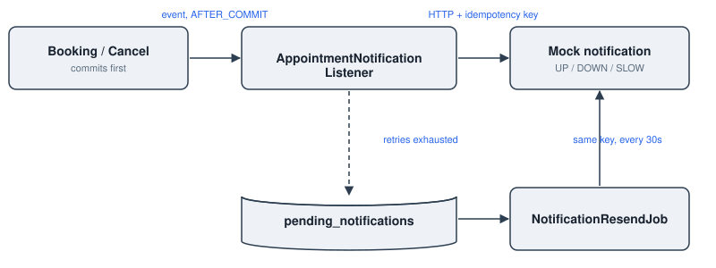
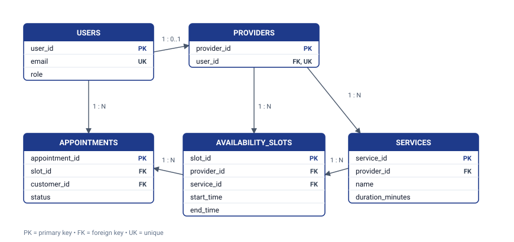

# TutorSlot

[](https://github.com/KhangPham05/TutorSlot/actions/workflows/ci.yml)


TutorSlot is a tutoring appointment booking app with a built-in **AI booking agent**. Students
can browse tutors' open time slots and book on the web, or just tell the assistant what they
need in plain language: *"find me a Calculus slot this week and book it"*, *"cancel my Physics
session"*, *"what's your cancellation policy?"*. Tutors publish the hours they teach, and a
second agent works in the background, sending each student a short personal reminder before
their session.

What it does:

- **Book by chatting with an AI agent.** The assistant finds open slots, books and cancels
  sessions, and lists your appointments. It always shows the details and asks before it books or
  cancels anything.
- **Policy answers you can trust.** Questions about hours, cancellations, or no-shows are
  answered from TutorSlot's own policy document (RAG), never made up.
- **Automatic reminders.** A scheduled agent writes a friendly reminder for every session in the
  next 24 hours and emails it to the student.
- **A Next.js web app.** Browse, filter, book, and cancel slots, and chat with the assistant;
  tutors manage their slots from a dashboard. It talks to the Spring Boot backend through a JSON
  API secured with JWT.

Under the hood it's built to behave like a real service: **race-free booking** (two students can
never win the same slot, whether they use the web app or the agent), a **real network boundary**
to a notification service that can be killed and slowed down on command, and the **ops basics**:
logs, health, metrics, Docker, and CI. The AI runs on Spring AI and the free Gemini API, and it's
optional: without an API key the app still runs, the chat assistant is simply switched off, and
reminders go out as a plain template.

## Project milestones

Built in four milestones. Each report covers the design, the decisions, and the tests, and links
its demo video.

| Milestone | What it added | Report and demo |
|---|---|---|
| 1. Foundation | The database schema and sample data, and a layered Spring Boot skeleton with read-only home and slot pages | [Milestone 1 report](https://docs.google.com/document/d/1FdjVf5WMDM2bnruZAH_9yNpSmPfSSHt1-L0h2ZfMJ6g/edit?usp=sharing) |
| 2. Booking | Login with two roles, slot search and paging, booking that can never double-book (row lock and a partial unique index), cancelling, and the tutor dashboard | [Milestone 2 report](https://docs.google.com/document/d/1RKEh6nZdu90lBLhoBK8O4jnNGlggVO6vAogd28SX_oE/edit?usp=sharing) |
| 3. Production ready | Notifications over a real HTTP boundary with timeouts, retries, and a resend queue; logs, health, metrics, Docker, and CI | [Milestone 3 report](https://docs.google.com/document/d/17nUPhu_X9yTa5wd1nMJoan8L1GbxzRSx_Mi69JnB8sU/edit?usp=sharing) |
| 4. Enterprise AI | A chat agent that books and cancels through tools and always asks first, a reminder agent, and policy answers grounded in a knowledge file (Spring AI and Gemini); a Next.js frontend on a JWT API; Flyway migrations so data survives restarts | [Milestone 4 report](https://docs.google.com/document/d/1qObcvqv-g0Xt5QK4d6aJ66JIsH1XzSaBrs1Bxqyn9m0/edit?usp=sharing) |

## Quick start

Needs Java 21 and a local PostgreSQL with a `tutorslot_db` database (`postgres`/`postgres` by
default — override with the `DB_USERNAME`/`DB_PASSWORD` env vars). No Postgres handy? Skip to
[Docker](#docker) instead, which brings its own.

```bash
./mvnw spring-boot:run
```
On the first start, Flyway creates the tables and loads sample data. After that your data is
kept across restarts. Nothing to configure first.

Then start the Next.js app in a second terminal (needs Node 20.9 or newer):
```bash
cd frontend
npm install
npm run dev
```
Visit **http://localhost:3000** and log in with a seeded account. (The original server-rendered
pages still work too, at http://localhost:8080.)

| Role | Email | Password |
|---|---|---|
| Customer | `dan.student@sjsu.edu` | `password123` |
| Provider | `alice.tutor@sjsu.edu` | `password123` |

(8 seeded users total — full roster in `src/main/resources/db/migration/V2__seed_data.sql`. Every account shares the
same password.)

**Turn on the AI agents (optional).** Get a free Gemini API key (see
[Setup](#setup-a-free-gemini-key)), put it in a `.env` file in the project root, and start the app
with it loaded:
```bash
echo 'GEMINI_API_KEY=your-key-here' > .env
set -a; source .env; set +a
./mvnw spring-boot:run
```
Without a key everything else works the same, and the Assistant page says it isn't configured.

Prefer containers?
```bash
docker compose up --build
```
Three services, `db`, `app`, and the Next.js `web` app on http://localhost:3000. See
[Docker](#docker) below for the stop/start failure demo.

## At a glance

| | |
|---|---|
| **Stack** | Java 21 · Spring Boot 3.5.3 · PostgreSQL · plain SQL via `JdbcTemplate` (no ORM) · Flyway migrations · Next.js 16 (React 19, TypeScript) |
| **Auth** | Spring Security, two roles (`CUSTOMER` / `PROVIDER`): JWT for the JSON API, session login with CSRF for the server-rendered pages |
| **Concurrency** | Pessimistic row locks + a partial unique index as the real backstop — see below |
| **Integration** | A real HTTP boundary to a mock notification service — timeouts, retry, idempotent fallback |
| **Ops** | `/health`, Micrometer metrics, structured logs, Docker, GitHub Actions CI |
| **AI** | Spring AI 1.1.8 · Gemini free tier · tool calling, chat memory, a scheduled agent, RAG over a knowledge file |
| **Tests** | 79 tests — unit (Mockito) + integration (`@SpringBootTest`, real Postgres, real JWTs) — none calls Gemini; CI also builds the Next.js app |

## How the AI works

Three AI features live in `com.tutorslot.ai`. Each one is a thin layer over the same services
the web pages use, so the agents follow exactly the same rules as a person clicking buttons.

### The booking agent

Students click **Assistant** in the navbar (`/customer/assistant`) and chat in plain language:

- *What's your cancellation policy?*
- *Find the earliest Calculus slot this week and book it* (it shows the slot and asks "Shall I
  confirm?"; reply *yes*)
- *What sessions do I have coming up?*
- *Cancel my Calculus session*

**New conversation** clears the chat. Gemini answers by calling six tools in `AssistantTools`,
each a thin wrapper around an existing service:

| Tool | Calls |
|---|---|
| `findAvailableSlots` | `AvailabilitySlotService.getAvailableSlotsPage` (up to 3 pages, filtered in Java, no new SQL) |
| `listMyAppointments` | `AppointmentService.getMyAppointments` |
| `proposeBooking`, `proposeCancellation` | Only save a proposal. Nothing is written |
| `confirmPendingAction` | `BookingFacade.book` or `AppointmentService.cancel` |
| `searchPolicies` | The knowledge file's vector store (see below) |

The safety rules are enforced in code, not just asked for in the prompt:

- **The customer id never comes from the AI.** The controller takes it from the login session and
  passes it to the tools through Spring AI's *tool context*, which the model never sees. No tool
  has a user id parameter, so no message can make it book for someone else.
- **Confirm before writing.** Each proposal remembers the turn (message number) it was made in,
  and `confirmPendingAction` only carries out a proposal from an *earlier* turn. So nothing is
  booked or cancelled until the student has seen the details and sent a new message, even if the
  model tries to do it in one step.
- **Same rules as the web pages.** Writes go through `BookingFacade` and
  `AppointmentService.cancel`, so the row lock, the unique index, the owner check, and the
  confirmation email all still apply. If a slot was taken in the meantime, the tool returns
  "already booked" together with the next open slots, and the assistant offers those.
- If Gemini is slow or down, the page shows a short "try again" message, never a stack trace.

### The reminder agent

`ReminderAgent` runs every 15 minutes. For each booked session starting in the next 24 hours that
hasn't had a reminder (at most 5 per run, to protect the free quota), it asks Gemini for a short,
friendly reminder and sends it through the same `NotificationGateway` as booking emails:

- Idempotency key `REMINDER-{appointmentId}`, so a retry or a resend can never email twice.
- If Gemini fails, or there's no key, it sends a template instead: *"Reminder: your {subject}
  session with {tutor} is on {time}."*
- If the notification service is down, the reminder waits in `pending_notifications` and the
  resend job delivers it later.
- The appointment's `reminder_sent_at` is then set, so the next run doesn't pay for it again.

Tutors can run it right away with **Send reminders now** on the dashboard
(`POST /provider/reminders/run`). The seed data has three sessions tomorrow (10 AM, 11 AM, and
1 PM), so a click sends a reminder for each one that starts within the next 24 hours (all three
in the afternoon), and a second click sends none. To read what was sent:

```bash
curl http://localhost:8080/mock-notify/notifications -H "X-Api-Key: dev-key"
```

### Policy answers from a knowledge file (RAG)

`src/main/resources/knowledge/tutorslot-policies.md` covers tutoring hours, how booking works,
the cancellation and no-show policies, subjects and tutors, session length, reminders, and how to
get help. At startup (only with a key) it's split into one passage per `##` section and embedded
with `gemini-embedding-001` into an in-memory `SimpleVectorStore`. The `searchPolicies` tool
returns the 3 closest passages, and the assistant answers only from them; if none fits, it says
it doesn't know. Edit the file and restart to change the answers. A policy question costs one
embedding call, and booking messages cost none.

### Setup: a free Gemini key

1. Open [Google AI Studio](https://aistudio.google.com), sign in, and choose **Get API key**, then
   **Create API key**. Create it in a project with no billing account, so it can only ever use
   the free tier.
2. Save it in a `.env` file in the project root: `GEMINI_API_KEY=your-key-here`. `.env` is in
   `.gitignore` and `.dockerignore`, so it is never committed or copied into the Docker image.
3. Locally, load it with `set -a; source .env; set +a` before `./mvnw spring-boot:run`. Docker
   Compose reads `.env` by itself.

At startup the log says `Gemini AI features enabled`, or `disabled (no GEMINI_API_KEY set)`.
Only the API key is configured, never `project-id` or `location`: those switch Spring AI to
Vertex AI, which rejects a free key.

| Setting | Default | What it is |
|---|---|---|
| `GEMINI_MODEL` | `gemini-3.5-flash-lite` | Chat model, free tier. Chosen after timing the free Flash models; others were slower or overloaded |
| embedding model | `gemini-embedding-001` | Turns the knowledge file into vectors |
| `gemini.timeout-ms`, `gemini.max-attempts` | `20000`, `2` | Upper limit for one Gemini call, so a slow free tier can't hang a page |

**With no key**, nothing calls Gemini: the Assistant page says "The assistant is not
configured.", reminders use a plain template, and the knowledge file isn't embedded.

### Privacy and logs

- **Sent to Gemini:** the student's chat messages and the tool results (open slots, their own
  appointments, policy passages). For reminders, only the student's first name, the subject, the
  tutor, and the time. Never emails, passwords, or appointment notes.
- **Logged:** one line per tool call (`AI tool call: tool=proposeBooking user=5 slot=7`) and per
  reminder (`Reminder sent: appointment=12 source=ai`). Never the student's messages, their
  notes, the reminder text, or the API key.

## The Next.js app and the JWT API

The web app in `frontend/` is a Next.js 16 app (React 19, TypeScript). It holds no business
rules: every page calls the Spring Boot backend's JSON API, and the backend stays the only place
that decides who can book, cancel, or see what.

How a request travels:

1. **Log in.** The login page posts the email and password to `POST /api/auth/login`. The backend
   checks them exactly like the web form does (same users table, same BCrypt check) and returns a
   signed JWT that is valid for 2 hours. The token holds only the user's email, their role, and
   its times. Anyone holding a token can read it, so nothing private goes in.
2. **Keep the token.** The app saves it in the tab's `sessionStorage`: a refresh keeps you logged
   in, and closing the tab logs you out.
3. **Call the API.** Every request sends `Authorization: Bearer <token>`. The browser only talks
   to the Next.js server, which passes `/api/...` on to Spring (`next.config.ts`), so there is one
   address and no CORS setup.
4. **Check the token.** On the backend, `ApiSecurityConfig` is a second security chain just for
   `/api/**`. It checks the signature, the expiry, and the issuer, turns the token's role into
   `ROLE_CUSTOMER` or `ROLE_PROVIDER`, and applies the same role rules as the web pages. The user
   always comes from the token, never from the request body.

Security choices worth knowing:

- **Stateless.** The API chain never creates or reads a session, so a browser's web login cookie
  does nothing there (`ApiAuthTest` proves it). That's why CSRF protection, which guards against
  forged requests that ride on cookies, can be off for `/api/**` alone. The server-rendered pages
  keep their session login and CSRF exactly as before.
- **One secret.** Tokens are signed with HS256 using `JWT_SECRET` (at least 32 characters, from
  the environment only). With none set, the app makes a random key at startup, so nothing secret
  is ever in the repo; logins then just end when the backend restarts.
- **One answer for a wrong password or an unknown email** (401 "Wrong email or password."), so
  nobody can probe which accounts exist.
- **Short JSON errors.** `ApiExceptionHandler` maps the same exceptions as the web pages to the
  same status codes, with a small `{"error": "..."}` body. No stack trace or internal message
  reaches the browser.

| Method | URL | Who | Purpose |
|---|---|---|---|
| POST | `/api/auth/login` | public | Email and password in, JWT out |
| GET | `/api/me` | logged in | Who the token belongs to |
| GET | `/api/slots` | public | Open slots with filters, paging, and the dropdown options |
| GET | `/api/slots/{id}` | public | One slot |
| POST | `/api/customer/bookings` | CUSTOMER | Book (409 if the slot was just taken) |
| GET | `/api/customer/appointments` | CUSTOMER | Upcoming and history |
| GET | `/api/customer/appointments/{id}` | CUSTOMER, owner | Booking confirmation |
| POST | `/api/customer/appointments/{id}/cancel` | CUSTOMER, owner | Cancel |
| GET, POST | `/api/customer/assistant` | CUSTOMER | Is the assistant on; send one message |
| POST | `/api/customer/assistant/reset` | CUSTOMER | New conversation |
| GET | `/api/provider/dashboard` | PROVIDER | My slots and subjects |
| POST | `/api/provider/slots` | PROVIDER | Add a slot |
| POST | `/api/provider/slots/{id}/delete` | PROVIDER, owner | Remove a slot (only if never booked) |
| GET | `/api/provider/appointments` | PROVIDER | Sessions booked with me |
| POST | `/api/provider/reminders/run` | PROVIDER | Send due reminders now |

Every endpoint calls the same service method as the matching server-rendered page, so a booking
from the Next.js app, the old page, or the AI assistant goes through the same `BookingFacade`,
row lock, and unique index. The assistant's confirm-before-booking turn counter is shared too
(`AssistantTurns`).

## Architecture



One direction only. Controllers touch HTTP and Thymeleaf views, never SQL or business rules.
Services hold the business rules — including the booking transaction — and shape repository
models into view-facing DTOs. Repositories are one class per table, plain `JdbcTemplate` /
`NamedParameterJdbcTemplate` + `RowMapper`, nothing generated. A small, centralized
`GlobalExceptionHandler` turns three custom exceptions (`NotFoundException`,
`ForbiddenException`, `SlotConflictException`) into the right HTTP status and error page — a
stack trace never reaches the browser.

Notifications live behind their own boundary:



`com.tutorslot.notification` (this app) and `com.tutorslot.mocknotification` (standing in for a
real third party) share **zero Java classes** — only an agreed JSON shape, like any real
external API integration. Booking and cancelling publish an event *inside* their own
transaction; the listener only fires `AFTER_COMMIT`, off the request thread (`@Async`), so a
slow notification service can never hold a booking's row lock or make a student wait. If every
retry fails, the notification lands in `pending_notifications` instead of being lost, and a
scheduled job keeps retrying it with the same idempotency key until it succeeds.

<details>
<summary><strong>Booking concurrency, in depth</strong> — how two students racing for the same slot can never both win</summary>

<br>

**`BookingService.book(slotId, customerId, notes)`** is `@Transactional` at `READ COMMITTED`
(Postgres's default, set explicitly so it's visible in the code) and does, in order:
1. `SELECT ... FROM availability_slots WHERE slot_id = ? FOR UPDATE` — locks the row. A second
   transaction trying to book the same slot blocks here until the first commits or rolls back.
2. Checks the slot's `start_time` is still in the future.
3. Checks whether the slot already has an active `BOOKED` appointment.
4. Inserts the new appointment.

Why `READ COMMITTED` specifically matters: because it re-reads on every new statement, the second
(now-unblocked) transaction's step 3 check sees the first transaction's just-committed booking
and correctly reports a conflict. Under `REPEATABLE READ`, step 3 would still see the pre-lock
snapshot and miss it — only the database's own unique index would catch it at that point.

**The backstop**: even if the row lock were somehow bypassed, the partial unique index itself
(`uq_one_active_booking_per_slot`) rejects a second `BOOKED` row for the same slot with a
`DuplicateKeyException`, which `BookingService` translates into the same `SlotConflictException`
(409) a normal conflict produces. This is the layer that actually guarantees correctness — the
row lock is an optimization that avoids unnecessary conflicts and retries, not the source of truth.

**`BookingFacade`** wraps `BookingService.book()` in a retry loop (up to 3 attempts, short sleep
between) that retries only a transient lock-acquisition failure
(`PessimisticLockingFailureException`) — never `SlotConflictException`, a real conflict, not a
temporary one. It's a separate Spring bean on purpose: a `@Transactional` method called from
another method on the *same* class bypasses Spring's proxy, so no transaction would actually
start on a retry. Controllers call this facade, never `BookingService` directly.

`BookingConcurrencyTest` proves this holds under real concurrency: two threads racing to book the
same slot via a `CountDownLatch` start gate — exactly one succeeds, the database ends up with
exactly one `BOOKED` row — and proves the backstop in isolation (two direct JDBC inserts, the
second throws `DuplicateKeyException`).

</details>

<details>
<summary><strong>Notification resilience, in depth</strong> — timeouts, retry, idempotency, and the two real bugs it surfaced</summary>

<br>

**Timeouts**: connect 500ms, read 1500ms, on the `RestClient`'s request factory — without this a
hung service holds a thread forever. **Retry**: up to 3 attempts, 200ms then 400ms backoff,
*only* on a timeout/connection failure or a 5xx — never on a 4xx, since that's this app's own bug
and retrying can't fix it. **Fallback**: on total failure the gateway returns a failed result and
never throws; the booking itself is never affected either way. Every attempt — and every later
resend-job cycle — carries the *same* idempotency key (`BOOKED-{id}` / `CANCELLED-{id}`), so the
mock reports `DUPLICATE` instead of ever storing the same notification twice, no matter how many
times it's retried or from which source.

Adding proper logging surfaced two gaps, both fixed:
- `GlobalExceptionHandler`'s catch-all was silently turning an unmatched route into a 500 instead
  of a 404 — a `NoResourceFoundException` landing in the same handler as everything else.
- Spring Security's own role-gate 403 (a logged-in customer hitting `/provider/**`) never reached
  `GlobalExceptionHandler` at all — it's resolved entirely inside the security filter chain. A
  small custom `AccessDeniedHandler` now logs it too, rendering the exact same page as before.

</details>

## Database design

Six tables. `services` holds the subjects a tutor teaches; `availability_slots` are the bookable
time windows; a slot is "available" when it's in the future and has no active `BOOKED`
appointment — computed at query time, never stored as a column. The double-booking guard lives
in the database itself: a partial unique index, `UNIQUE (slot_id) WHERE status = 'BOOKED'`.



Only keys and the fields that matter for the flow are shown (`role`, `status`, slot timing) —
every constraint is in `db/migration/V1__create_schema.sql`. The sixth table, `pending_notifications`, has no foreign
keys and isn't part of the booking domain — it's the durable queue behind the notification
recovery job, so it isn't pictured. Also not pictured: `appointments.reminder_sent_at`, set once
the reminder agent has handled an appointment.

## Pages and endpoints

The server-rendered pages (Thymeleaf, session login). The JSON API the Next.js app uses is listed
in [The Next.js app and the JWT API](#the-nextjs-app-and-the-jwt-api).

| Method | URL | Who | Purpose |
|---|---|---|---|
| GET | `/` | public | Home — tutors and the subjects they teach |
| GET | `/slots` | public | Browse, filter (tutor/subject/date), and paginate available slots |
| GET | `/login` | public | Login form |
| POST | `/logout` | logged in | Logout |
| GET | `/customer/book?slotId=` | CUSTOMER | Book form — slot summary + optional notes |
| POST | `/customer/book` | CUSTOMER | Submit the booking, redirect to confirmation |
| GET | `/customer/appointments/{id}/confirmation` | CUSTOMER, owner | Confirmation page |
| GET | `/customer/appointments` | CUSTOMER | My appointments — Upcoming and History |
| POST | `/customer/appointments/{id}/cancel` | CUSTOMER, owner | Cancel an upcoming appointment |
| GET | `/customer/assistant` | CUSTOMER | The AI booking assistant (chat page) |
| POST | `/customer/assistant` | CUSTOMER | Send one message to the assistant |
| POST | `/customer/assistant/reset` | CUSTOMER | New conversation |
| GET | `/provider/dashboard` | PROVIDER | My slots (booked/open) + create-slot form |
| POST | `/provider/slots` | PROVIDER | Create a slot |
| POST | `/provider/slots/{id}/delete` | PROVIDER, owner | Remove a slot (only if never booked) |
| GET | `/provider/appointments` | PROVIDER | Appointments booked with me |
| POST | `/provider/reminders/run` | PROVIDER | Send due appointment reminders now |

A logged-in user hitting a page outside their role gets a `403` page, not a redirect to login. A
logged-out user hitting a protected page is sent to `/login`.

## Notifications and the mock service

Booking or cancelling sends the student a confirmation (and the reminder agent sends reminders,
with keys `REMINDER-{id}`) through a mock external service living in this same app, reachable only over HTTP + an API key (`X-Api-Key: dev-key` by default) — flip
its mode at runtime to demo an outage, no restart needed:

| Mode | Behavior |
|---|---|
| `UP` (default) | Accepts and stores the notification, `202 Accepted` |
| `DOWN` | Every request returns `503` |
| `SLOW` | Sleeps 5 seconds — longer than the client's 1500ms read timeout |

```bash
curl -X POST http://localhost:8080/mock-notify/admin/mode/DOWN -H "X-Api-Key: dev-key"
# book a slot now -- it still succeeds; the notification queues instead of being lost

curl -X POST http://localhost:8080/mock-notify/admin/mode/UP -H "X-Api-Key: dev-key"
# within notification.resend-interval-ms (30s default) the queued notification gets delivered

curl http://localhost:8080/mock-notify/notifications -H "X-Api-Key: dev-key"   # see everything received
```

## Health and metrics

```bash
curl http://localhost:8080/health                                       # {"status":"UP",...,"db":{...}}
curl http://localhost:8080/metrics/tutorslot.bookings                   # outcome=success|conflict|error
curl http://localhost:8080/metrics/tutorslot.booking.latency            # average and max booking time
curl http://localhost:8080/metrics/tutorslot.notifications              # result=sent|retry|fallback|failed
```

`/health` only reflects the database connection, deliberately — a notification outage is
visible through the `tutorslot.notifications` metric and the console logs instead. If it flipped
`/health` too, a container orchestrator would restart a perfectly healthy app over a problem
restarting it can't fix.

## Docker

```bash
docker compose up --build
```
Three services:
- `db`: `postgres:16` with a named volume, not published on the host (5432 is likely already
  your own local Postgres).
- `app`: the Spring Boot backend, built from the `Dockerfile`, on `8080:8080`. The mock
  notification service runs inside the same container, so its base URL stays `localhost:8080`.
- `web`: the Next.js app, built from `frontend/Dockerfile`, on `3000:3000`. Open
  **http://localhost:3000**. It passes `/api` calls on to `app` over the compose network, and the
  image holds only Next.js's small standalone server, running as a non-root user.

Compose passes `GEMINI_API_KEY` and, optionally, `JWT_SECRET` from the `.env` file next to
`docker-compose.yml`. With no key, the app starts with the AI features turned off; with no
`JWT_SECRET`, logins end whenever the `app` container restarts. The app container runs on
Pacific time (`TZ`), the same clock tutors use for slot times; on the default UTC, the evening's
slots would count as already past.

The database lives in the named volume, so bookings survive `docker compose restart app` and a
full `docker compose down` and `up`. Only `down -v` deletes it.

```bash
docker compose stop db     # /health now returns 503
docker compose start db    # back to 200 UP within a few seconds
docker compose down -v     # stop everything and delete the data; the next up starts fresh
```

## Testing

```bash
./mvnw test
```
**79 tests**: unit tests (Mockito, or `MockRestServiceServer` for the HTTP gateway — no Spring
context, no database) covering booking, cancellation, slot management, and notification
retry/backoff; integration tests (`@SpringBootTest`, real local Postgres) covering the full
booking-concurrency race, the health endpoint over real HTTP, and
`BookingWithNotificationDownTest` — proving a booking survives an unreachable *and* a slow
notification service, and that a rejected booking never queues a notification at all.

The AI tests **never call Gemini** (CI has no key). They cover the tools and the confirm rule
(`AssistantToolsTest`), the chat service with a mocked chat model (`AssistantServiceTest`), the
reminder agent's AI text, template fallback, per-run cap, and resend queue
(`ReminderAgentTest`), splitting the knowledge file (`PolicySearchServiceTest`), the reminder
query on real Postgres (`AppointmentReminderQueryTest`), and `AssistantBookingGuardTest`: two
students confirm the same slot through the agent's tool at the same moment, and exactly one of
them gets it.

The JSON API tests (`ApiAuthTest`, `CustomerApiTest`, `ProviderApiTest`) log in through the real
`/api/auth/login` and use the real tokens against the real services and Postgres. They cover a
good and a bad login, a forged and an expired token, a web session that must not open the API,
booking, a slot taken a moment earlier (409), cancelling, one student or tutor touching
another's data (403), the wrong role (403), and adding and removing slots.

Tests use their own schema, `tutorslot_test`, inside the same database. Flyway creates it on
first use, and `TestDatabaseConfig` wipes and rebuilds it from the app's migration files before
each test context, so every run starts fresh. The app's data is never touched, and the app and
the tests can run at the same time. `RestartKeepsDataTest` checks the restart fix: running the
migrations again, exactly as a restart does, changes no rows. (The same test-only
`src/test/resources/config/application.properties` also stops the reminder job from running on
its own during tests.)

CI (`.github/workflows/ci.yml`) runs the same `./mvnw -B verify` against a real `postgres:16`
service container on every push, builds the Next.js app (`npm ci` and `npm run build`, which
also type-checks it), then confirms both Docker images still build.

```bash
./mvnw clean package   # build a jar
```

<details>
<summary><strong>Folder structure</strong></summary>

<br>

```
TutorSlot/
├── pom.xml
├── mvnw, mvnw.cmd                     # Maven wrapper — build/run without a local Maven install
├── Dockerfile, .dockerignore          # multi-stage build; see "Docker" above
├── docker-compose.yml                 # db, app, and web services
├── .github/workflows/ci.yml           # tests, a Next.js build, and docker build checks, on every push
├── docs/er-diagram.svg                # ER diagram used in this README
├── src/
│   ├── main/
│   │   ├── java/com/tutorslot/
│   │   │   ├── TutorSlotApplication.java      # Spring Boot entry point
│   │   │   ├── controller/                    # HomeController, SlotController, LoginController,
│   │   │   │                                  #   BookingController, AppointmentController,
│   │   │   │                                  #   ProviderController
│   │   │   ├── controller/api/                # the JSON API for the Next.js app -- AuthApiController,
│   │   │   │                                  #   SlotApiController, CustomerApiController,
│   │   │   │                                  #   AssistantApiController, ProviderApiController
│   │   │   ├── security/                      # SecurityConfig (web pages), ApiSecurityConfig (/api, JWT),
│   │   │   │                                  #   JwtConfig, TokenService, AppUserDetailsService,
│   │   │   │                                  #   UserPrincipal
│   │   │   ├── service/                       # ProviderService, AvailabilitySlotService,
│   │   │   │                                  #   BookingService, BookingFacade, AppointmentService,
│   │   │   │                                  #   ProviderDashboardService, CurrentUserService
│   │   │   ├── repository/                    # UserRepository, ProviderRepository, SubjectRepository,
│   │   │   │                                  #   AvailabilitySlotRepository, AppointmentRepository,
│   │   │   │                                  #   PendingNotificationRepository
│   │   │   ├── model/                         # User, Provider, Subject, AvailabilitySlot, Appointment,
│   │   │   │                                  #   PendingNotification
│   │   │   ├── dto/                           # view-facing DTOs (one per page/concern)
│   │   │   ├── exception/                     # NotFoundException, ForbiddenException, SlotConflictException
│   │   │   ├── web/                           # GlobalExceptionHandler (pages), ApiExceptionHandler (JSON)
│   │   │   ├── ai/                            # the AI agents -- AssistantTools, AssistantService,
│   │   │   │                                  #   PendingActionStore, PolicySearchService,
│   │   │   │                                  #   ReminderAgent, AssistantTurns, AiAvailability, AiConfig,
│   │   │   │                                  #   GeminiText
│   │   │   ├── notification/                  # the client side of the distribution boundary --
│   │   │   │                                  #   NotificationGateway, HttpNotificationGateway,
│   │   │   │                                  #   AppointmentNotificationListener, NotificationResendJob,
│   │   │   │                                  #   NotificationAsyncConfig, NotificationClientConfig
│   │   │   └── mocknotification/               # the mock external service side --
│   │   │                                      #   MockNotificationController, InMemoryNotificationStore,
│   │   │                                      #   NotificationModeHolder (UP/DOWN/SLOW)
│   │   └── resources/
│   │       ├── db/migration/                   # Flyway, each file runs once:
│   │       │                                   #   V1__create_schema.sql (6 tables + constraints),
│   │       │                                   #   V2__seed_data.sql (sample tutors, students, slots)
│   │       ├── application.properties
│   │       ├── knowledge/tutorslot-policies.md # the RAG knowledge file
│   │       └── templates/
│   │           ├── home.html, slots.html, login.html
│   │           ├── customer/                   # book.html, confirmation.html, appointments.html,
│   │           │                               #   assistant.html
│   │           ├── provider/                   # dashboard.html, appointments.html
│   │           ├── error/                      # 400, 403, 404, 409, 500
│   │           └── fragments/                  # navbar.html (role-aware, sec:authorize)
│   └── test/
│       ├── resources/config/application.properties   # test-only overrides (own schema)
│       └── java/com/tutorslot/
│           ├── TestDatabaseConfig.java         # fresh test schema for each test context
│           ├── security/ApiAuthTest.java       # JWT login, forged/expired tokens, no session on /api
│           ├── controller/api/                 # CustomerApiTest, ProviderApiTest (real tokens),
│           │                                   #   ApiLogin (logs a seeded user in for a token)
│           ├── ai/                             # AssistantToolsTest, AssistantServiceTest,
│           │                                   #   ReminderAgentTest, PolicySearchServiceTest,
│           │                                   #   AssistantBookingGuardTest (two confirms, one slot)
│           ├── repository/RepositorySmokeTest.java, AppointmentReminderQueryTest.java,
│           │                                   #   RestartKeepsDataTest (a restart keeps every row)
│           ├── dto/CreateSlotRequestTest.java      # Bean Validation on the slot-creation form
│           ├── web/HealthEndpointTest.java         # GET /health over real HTTP, through Spring Security
│           ├── notification/
│           │   ├── HttpNotificationGatewayTest.java   # MockRestServiceServer — retry, backoff, 4xx vs 5xx
│           │   └── NotificationResendJobTest.java
│           └── service/
│               ├── ServiceLayerSmokeTest.java
│               ├── BookingServiceTest.java         # Mockito, no Spring context
│               ├── BookingFacadeTest.java          # retry behavior + the bookings/latency meters
│               ├── AppointmentServiceCancelTest.java
│               ├── ProviderDashboardServiceTest.java
│               ├── BookingConcurrencyTest.java     # two bookings racing for one slot
│               └── BookingWithNotificationDownTest.java   # booking with notifications down or slow
└── frontend/                          # the Next.js app (React 19, TypeScript)
    ├── package.json, package-lock.json  # pinned versions; npm ci installs exactly these
    ├── next.config.ts                 # passes /api/... on to the Spring Boot backend
    ├── Dockerfile                     # build, then a small standalone server image
    ├── app/                           # one folder per page: login, slots, book/[slotId],
    │                                  #   appointments, appointments/[id], assistant,
    │                                  #   tutor, tutor/appointments
    ├── components/                    # Navbar, RequireRole, AppointmentTable
    └── lib/                           # api.ts (token + errors), auth.tsx (login state),
                                       #   useApi.ts, format.ts, types.ts
```

</details>

## Known limitations

- The assistant's chat memory, its pending proposals, and the vector store are kept in memory,
  so a restart clears conversations and re-embeds the knowledge file (8 small embedding calls).
  Bookings and the notification queue are in PostgreSQL and survive restarts.
- The sample slots are dated from the day the database was first created, so after about a week
  they are all in the past. Tutors can add new ones, or `docker compose down -v` starts fresh.
- A database created by an older copy of this app (before Flyway) has tables Flyway didn't make,
  and the app stops at startup instead of touching them: "Found non-empty schema(s) "public" but
  no schema history table". Empty it once: `docker compose down -v` for Docker, or drop the six
  tables in a local `tutorslot_db`.
- The free Gemini tier is sometimes slow. A call that takes longer than 20 seconds shows "try
  again" on the chat page, and a reminder falls back to the template.
- The Next.js app keeps its token in `sessionStorage`, where the page's own scripts can read it.
  React escapes everything it shows, which guards against injected scripts, but an `httpOnly`
  cookie would be stronger. There is no refresh token either: after 2 hours, you log in again.
- The server-rendered Thymeleaf pages still run alongside the Next.js app on port 8080. Both use
  the same services and data, so either one can be used.
