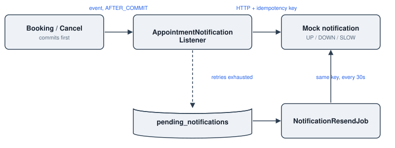

# TutorSlot

[](https://github.com/KhangPham05/TutorSlot/actions/workflows/ci.yml)


A tutoring appointment booking system for SJSU CMPE 172. Students browse tutors' open time
slots and book a session; tutors publish the availability they teach. Under the hood it's a
case study in three things done properly: **race-free booking** (two students can never win the
same slot), a **real distribution boundary** to a mock notification service that can be killed
and slowed down on command, and the **ops basics** — logs, health, metrics, Docker, CI — that
turn a class project into something that behaves like a real service.

Built in 4 milestones; **this repo currently implements 1 through 3**. Milestone 4 (the AI
booking agent / RAG Q&A) isn't here yet.

## Quick start

Needs Java 21 and a local PostgreSQL with a `tutorslot_db` database (`postgres`/`postgres` by
default — override with the `DB_USERNAME`/`DB_PASSWORD` env vars). No Postgres handy? Skip to
[Docker](#docker) instead, which brings its own.

```bash
./mvnw spring-boot:run
```
Recreates the schema and loads sample data on every startup — nothing to configure first.
Visit **http://localhost:8080** and log in with a seeded account:

| Role | Email | Password |
|---|---|---|
| Customer | `dan.student@sjsu.edu` | `password123` |
| Provider | `alice.tutor@sjsu.edu` | `password123` |

(8 seeded users total — full roster in `src/main/resources/seed.sql`. Every account shares the
same password.)

Prefer containers?
```bash
docker compose up --build
```
Two services, `db` + `app` — see [Docker](#docker) below for the stop/start failure demo.

## At a glance

| | |
|---|---|
| **Stack** | Java 21 · Spring Boot 3.5.3 · PostgreSQL · plain SQL via `JdbcTemplate` (no ORM) |
| **Auth** | Spring Security, session-based, two roles (`CUSTOMER` / `PROVIDER`), CSRF on |
| **Concurrency** | Pessimistic row locks + a partial unique index as the real backstop — see below |
| **Integration** | A real HTTP boundary to a mock notification service — timeouts, retry, idempotent fallback |
| **Ops** | `/health`, Micrometer metrics, structured logs, Docker, GitHub Actions CI |
| **Tests** | 40 tests — unit (Mockito) + integration (`@SpringBootTest`, real Postgres) — 3 clean runs in a row |

## Architecture


One direction only. Controllers touch HTTP and Thymeleaf views, never SQL or business rules.
Services hold the business rules — including the booking transaction — and shape repository
models into view-facing DTOs. Repositories are one class per table, plain `JdbcTemplate` /
`NamedParameterJdbcTemplate` + `RowMapper`, nothing generated. A small, centralized
`GlobalExceptionHandler` turns three custom exceptions (`NotFoundException`,
`ForbiddenException`, `SlotConflictException`) into the right HTTP status and error page — a
stack trace never reaches the browser.

Notifications live behind their own boundary:



`com.tutorslot.notification` (this app) and `com.tutorslot.mocknotification` (standing in for a
real third party) share **zero Java classes** — only an agreed JSON shape, like any real
external API integration. Booking and cancelling publish an event *inside* their own
transaction; the listener only fires `AFTER_COMMIT`, off the request thread (`@Async`), so a
slow notification service can never hold a booking's row lock or make a student wait. If every
retry fails, the notification lands in `pending_notifications` instead of being lost, and a
scheduled job keeps retrying it with the same idempotency key until it succeeds.

<details>
<summary><strong>Booking concurrency, in depth</strong> — how two students racing for the same slot can never both win</summary>

<br>

**`BookingService.book(slotId, customerId, notes)`** is `@Transactional` at `READ COMMITTED`
(Postgres's default, set explicitly so it's visible in the code) and does, in order:
1. `SELECT ... FROM availability_slots WHERE slot_id = ? FOR UPDATE` — locks the row. A second
   transaction trying to book the same slot blocks here until the first commits or rolls back.
2. Checks the slot's `start_time` is still in the future.
3. Checks whether the slot already has an active `BOOKED` appointment.
4. Inserts the new appointment.

Why `READ COMMITTED` specifically matters: because it re-reads on every new statement, the second
(now-unblocked) transaction's step 3 check sees the first transaction's just-committed booking
and correctly reports a conflict. Under `REPEATABLE READ`, step 3 would still see the pre-lock
snapshot and miss it — only the database's own unique index would catch it at that point.

**The backstop**: even if the row lock were somehow bypassed, the partial unique index itself
(`uq_one_active_booking_per_slot`) rejects a second `BOOKED` row for the same slot with a
`DuplicateKeyException`, which `BookingService` translates into the same `SlotConflictException`
(409) a normal conflict produces. This is the layer that actually guarantees correctness — the
row lock is an optimization that avoids unnecessary conflicts and retries, not the source of truth.

**`BookingFacade`** wraps `BookingService.book()` in a retry loop (up to 3 attempts, short sleep
between) that retries only a transient lock-acquisition failure
(`PessimisticLockingFailureException`) — never `SlotConflictException`, a real conflict, not a
temporary one. It's a separate Spring bean on purpose: a `@Transactional` method called from
another method on the *same* class bypasses Spring's proxy, so no transaction would actually
start on a retry. Controllers call this facade, never `BookingService` directly.

`BookingConcurrencyTest` proves this holds under real concurrency: two threads racing to book the
same slot via a `CountDownLatch` start gate — exactly one succeeds, the database ends up with
exactly one `BOOKED` row — and proves the backstop in isolation (two direct JDBC inserts, the
second throws `DuplicateKeyException`).

</details>

<details>
<summary><strong>Notification resilience, in depth</strong> — timeouts, retry, idempotency, and the two real bugs it surfaced</summary>

<br>

**Timeouts**: connect 500ms, read 1500ms, on the `RestClient`'s request factory — without this a
hung service holds a thread forever. **Retry**: up to 3 attempts, 200ms then 400ms backoff,
*only* on a timeout/connection failure or a 5xx — never on a 4xx, since that's this app's own bug
and retrying can't fix it. **Fallback**: on total failure the gateway returns a failed result and
never throws; the booking itself is never affected either way. Every attempt — and every later
resend-job cycle — carries the *same* idempotency key (`BOOKED-{id}` / `CANCELLED-{id}`), so the
mock reports `DUPLICATE` instead of ever storing the same notification twice, no matter how many
times it's retried or from which source.

Two pre-existing gaps were found (not because the spec demanded a fix, but because adding proper
logging is what made them visible) and fixed along the way:
- `GlobalExceptionHandler`'s catch-all was silently turning an unmatched route into a 500 instead
  of a 404 — a `NoResourceFoundException` landing in the same handler as everything else.
- Spring Security's own role-gate 403 (a logged-in customer hitting `/provider/**`) never reached
  `GlobalExceptionHandler` at all — it's resolved entirely inside the security filter chain. A
  small custom `AccessDeniedHandler` now logs it too, rendering the exact same page as before.

</details>

## Database design

Six tables. `services` holds the subjects a tutor teaches; `availability_slots` are the bookable
time windows; a slot is "available" when it's in the future and has no active `BOOKED`
appointment — computed at query time, never stored as a column. The double-booking guard lives
in the database itself: a partial unique index, `UNIQUE (slot_id) WHERE status = 'BOOKED'`.


Only keys and the fields that matter for the flow are shown (`role`, `status`, slot timing) —
every constraint is in `schema.sql`. The sixth table, `pending_notifications`, has no foreign
keys and isn't part of the booking domain — it's the durable queue behind the notification
recovery job, added after this diagram and not pictured.

## Pages and endpoints

| Method | URL | Who | Purpose |
|---|---|---|---|
| GET | `/` | public | Home — tutors and the subjects they teach |
| GET | `/slots` | public | Browse, filter (tutor/subject/date), and paginate available slots |
| GET | `/login` | public | Login form |
| POST | `/logout` | logged in | Logout |
| GET | `/customer/book?slotId=` | CUSTOMER | Book form — slot summary + optional notes |
| POST | `/customer/book` | CUSTOMER | Submit the booking, redirect to confirmation |
| GET | `/customer/appointments/{id}/confirmation` | CUSTOMER, owner | Confirmation page |
| GET | `/customer/appointments` | CUSTOMER | My appointments — Upcoming and History |
| POST | `/customer/appointments/{id}/cancel` | CUSTOMER, owner | Cancel an upcoming appointment |
| GET | `/provider/dashboard` | PROVIDER | My slots (booked/open) + create-slot form |
| POST | `/provider/slots` | PROVIDER | Create a slot |
| POST | `/provider/slots/{id}/delete` | PROVIDER, owner | Remove a slot (only if never booked) |
| GET | `/provider/appointments` | PROVIDER | Appointments booked with me |

A logged-in user hitting a page outside their role gets a `403` page, not a redirect to login. A
logged-out user hitting a protected page is sent to `/login`.

## Notifications and the mock service

Booking or cancelling sends the student a confirmation through a mock external service living in
this same app, reachable only over HTTP + an API key (`X-Api-Key: dev-key` by default) — flip
its mode at runtime to demo an outage, no restart needed:

| Mode | Behavior |
|---|---|
| `UP` (default) | Accepts and stores the notification, `202 Accepted` |
| `DOWN` | Every request returns `503` |
| `SLOW` | Sleeps 5 seconds — longer than the client's 1500ms read timeout |

```bash
curl -X POST http://localhost:8080/mock-notify/admin/mode/DOWN -H "X-Api-Key: dev-key"
# book a slot now -- it still succeeds; the notification queues instead of being lost

curl -X POST http://localhost:8080/mock-notify/admin/mode/UP -H "X-Api-Key: dev-key"
# within notification.resend-interval-ms (30s default) the queued notification gets delivered

curl http://localhost:8080/mock-notify/notifications -H "X-Api-Key: dev-key"   # see everything received
```

## Health and metrics

```bash
curl http://localhost:8080/health                                       # {"status":"UP",...,"db":{...}}
curl http://localhost:8080/metrics/tutorslot.bookings                   # outcome=success|conflict|error
curl http://localhost:8080/metrics/tutorslot.booking.latency            # average and max booking time
curl http://localhost:8080/metrics/tutorslot.notifications              # result=sent|retry|fallback|failed
```

`/health` only reflects the database connection, deliberately — a notification outage is
visible through the `tutorslot.notifications` metric and the console logs instead. If it flipped
`/health` too, a container orchestrator would restart a perfectly healthy app over a problem
restarting it can't fix.

## Docker

```bash
docker compose up --build
```
`db` (`postgres:16`, named volume, not published on the host — 5432 is likely already your own
local Postgres) and `app` (built from the `Dockerfile`, `8080:8080`). The mock notification
service runs inside the same `app` container, so its base URL stays `localhost:8080`, not
another service name.

```bash
docker compose stop db     # /health now returns 503
docker compose start db    # back to 200 UP within a few seconds
docker compose down -v     # stop everything and remove the volume
```

## Testing

```bash
./mvnw test
```
**40 tests**: unit tests (Mockito, or `MockRestServiceServer` for the HTTP gateway — no Spring
context, no database) covering booking, cancellation, slot management, and notification
retry/backoff; integration tests (`@SpringBootTest`, real local Postgres) covering the full
booking-concurrency race, the health endpoint over real HTTP, and the required
`BookingWithNotificationDownTest` — proving a booking survives an unreachable *and* a slow
notification service, and that a rejected booking never queues a notification at all. Run three
times in a row with a fresh database each time — identical 40/40 every run.

CI (`.github/workflows/ci.yml`) runs the same `./mvnw -B verify` against a real `postgres:16`
service container on every push, then confirms the Docker image still builds.

```bash
./mvnw clean package   # build a jar
```

<details>
<summary><strong>Folder structure</strong></summary>

<br>

```
TutorSlot/
├── pom.xml
├── mvnw, mvnw.cmd                     # Maven wrapper — build/run without a local Maven install
├── Dockerfile, .dockerignore          # multi-stage build; see "Docker" above
├── docker-compose.yml                 # app + db services
├── .github/workflows/ci.yml           # tests + a docker build check, on every push
├── docs/er-diagram.svg                # ER diagram used in this README
├── src/
│   ├── main/
│   │   ├── java/com/tutorslot/
│   │   │   ├── TutorSlotApplication.java      # Spring Boot entry point
│   │   │   ├── controller/                    # HomeController, SlotController, LoginController,
│   │   │   │                                  #   BookingController, AppointmentController,
│   │   │   │                                  #   ProviderController
│   │   │   ├── security/                      # SecurityConfig, AppUserDetailsService, UserPrincipal
│   │   │   ├── service/                       # ProviderService, AvailabilitySlotService,
│   │   │   │                                  #   BookingService, BookingFacade, AppointmentService,
│   │   │   │                                  #   ProviderDashboardService, CurrentUserService
│   │   │   ├── repository/                    # UserRepository, ProviderRepository, SubjectRepository,
│   │   │   │                                  #   AvailabilitySlotRepository, AppointmentRepository,
│   │   │   │                                  #   PendingNotificationRepository
│   │   │   ├── model/                         # User, Provider, Subject, AvailabilitySlot, Appointment,
│   │   │   │                                  #   PendingNotification
│   │   │   ├── dto/                           # view-facing DTOs (one per page/concern)
│   │   │   ├── exception/                     # NotFoundException, ForbiddenException, SlotConflictException
│   │   │   ├── web/                           # GlobalExceptionHandler (@ControllerAdvice)
│   │   │   ├── notification/                  # the client side of the distribution boundary --
│   │   │   │                                  #   NotificationGateway, HttpNotificationGateway,
│   │   │   │                                  #   AppointmentNotificationListener, NotificationResendJob,
│   │   │   │                                  #   NotificationAsyncConfig, NotificationClientConfig
│   │   │   └── mocknotification/               # the mock external service side --
│   │   │                                      #   MockNotificationController, InMemoryNotificationStore,
│   │   │                                      #   NotificationModeHolder (UP/DOWN/SLOW)
│   │   └── resources/
│   │       ├── schema.sql                      # all 6 tables + constraints, rerunnable
│   │       ├── seed.sql                        # sample tutors, students, subjects, slots, bookings
│   │       ├── application.properties
│   │       └── templates/
│   │           ├── home.html, slots.html, login.html
│   │           ├── customer/                   # book.html, confirmation.html, appointments.html
│   │           ├── provider/                   # dashboard.html, appointments.html
│   │           ├── error/                      # 400, 403, 404, 409, 500
│   │           └── fragments/                  # navbar.html (role-aware, sec:authorize)
│   └── test/java/com/tutorslot/
│       ├── repository/RepositorySmokeTest.java
│       ├── dto/CreateSlotRequestTest.java      # Bean Validation on the slot-creation form
│       ├── web/HealthEndpointTest.java         # GET /health over real HTTP, through Spring Security
│       ├── notification/
│       │   ├── HttpNotificationGatewayTest.java   # MockRestServiceServer — retry, backoff, 4xx vs 5xx
│       │   └── NotificationResendJobTest.java
│       └── service/
│           ├── ServiceLayerSmokeTest.java
│           ├── BookingServiceTest.java         # Mockito, no Spring context
│           ├── BookingFacadeTest.java          # retry behavior + the bookings/latency meters
│           ├── AppointmentServiceCancelTest.java
│           ├── ProviderDashboardServiceTest.java
│           ├── BookingConcurrencyTest.java     # the key M2 test
│           └── BookingWithNotificationDownTest.java   # the key M3 test
```

</details>

## Current scope

**Implemented (Milestones 1–3)**: the database schema, the full layered skeleton, login with
roles, browsing/filtering/paginating slots, booking with concurrency-safe locking, cancelling, a
provider dashboard for creating/removing slots, full validation/error handling (no stack traces
ever), a mock external notification service behind a real HTTP boundary with
retry/timeout/fallback and a recovery job, structured logging, `/health`, Micrometer metrics,
Docker, and CI.

**Not yet implemented**: the AI booking agent / RAG Q&A (Milestone 4).

**Known limitation**, noted here for the report, not a bug: `schema.sql` resets the database on
every app restart, so the notification queue survives an *outage of the notification service*
but not a restart of the app itself. A production version would stop resetting the schema.
