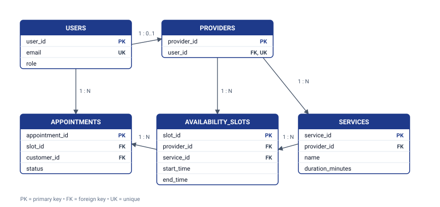

# TutorSlot

[](https://github.com/KhangPham05/TutorSlot/actions/workflows/ci.yml)

A tutoring appointment booking system built for SJSU CMPE 172. Students (customers) browse
tutors' open time slots and book sessions; tutors (providers) publish availability for the
subjects they teach.

This project is being built across 4 milestones. **This repository currently implements
Milestones 1 through 3**: the database, a layered Spring Boot skeleton, login with roles,
browsing/filtering/booking slots, cancelling appointments, a provider dashboard for managing
slots, a mock external notification service behind a real HTTP distribution boundary, logging,
a health endpoint, metrics, Docker, and a GitHub Actions CI pipeline. The AI agent / RAG features
are Milestone 4 and are not implemented yet.

## Tech stack

- Java 21, Spring Boot 3.5.3, Maven (with the Maven wrapper, so no local Maven install is needed)
- Spring Web, Thymeleaf (server-rendered views, Page Controller pattern)
- Spring Security (form login, session-based, CSRF on) + `thymeleaf-extras-springsecurity6` for
  role-aware navigation
- Jakarta Bean Validation (`spring-boot-starter-validation`) for form input
- Data access: plain SQL via `JdbcTemplate` / `NamedParameterJdbcTemplate` — no ORM, no Spring
  Data JPA, no `@Entity`
- PostgreSQL
- Spring's `RestClient` for the notification HTTP client (timeouts, hand-written retry with
  backoff — no Resilience4j or spring-retry, so it can be explained line by line)
- `spring-boot-starter-actuator` + Micrometer for `/health` and `/metrics`
- SLF4J logging to the console (`logging.level.com.tutorslot=INFO`)
- Docker (multi-stage `Dockerfile`, `docker-compose.yml`) and GitHub Actions CI

## Architecture

Strict layering, one direction only:

```
Controller -> Service -> Repository -> PostgreSQL
```

- **Controllers** handle HTTP and return Thymeleaf views. No SQL, no business logic.
- **Services** hold business rules (including the booking transaction) and convert repository
  models into view-facing DTOs.
- **Repositories** hold all the SQL, one class per table, using `JdbcTemplate`/
  `NamedParameterJdbcTemplate` + `RowMapper`.
- **Models** are plain Java records mirroring table rows.
- **DTOs** are plain Java records with only the fields a given page needs.
- **`security/`** wires up Spring Security: a `UserDetailsService` that loads users via
  `JdbcTemplate` (no Spring Data), and the URL/role rules.
- **`exception/` + `web/GlobalExceptionHandler`**: a small set of custom exceptions
  (`NotFoundException`, `ForbiddenException`, `SlotConflictException`) mapped centrally to HTTP
  status codes and their own error pages — never a stack trace, never a raw Spring message.

### The notification distribution boundary

`com.tutorslot.notification` (this app) and `com.tutorslot.mocknotification` (a stand-in for a
real third-party notification service) talk only over HTTP + JSON, as if they were genuinely
separate servers — they share zero Java classes, only an agreed JSON shape, exactly like a real
external API integration. They happen to run inside the same process for this project, but
nothing about the code depends on that: `NotificationGateway.send(NotificationRequest)` is a
single coarse-grained call (one network round trip per notification, not a chatty
create/set/send sequence), and the mock side has its own separate `IncomingNotification` DTO
rather than importing the gateway's.

Booking and cancelling publish an `ApplicationEventPublisher` event **inside** their existing
transaction; `AppointmentNotificationListener` picks it up with
`@TransactionalEventListener(phase = AFTER_COMMIT)` + `@Async`, so a notification is only ever
attempted for a booking that actually committed, and the student's page never waits on it. If
every retry fails, the notification is saved to `pending_notifications` instead of being lost,
and a `@Scheduled` job (`NotificationResendJob`) keeps retrying it with the same idempotency key
until it succeeds or hits 5 attempts. See "Notifications and the mock service" below for how to
see this live.

## Folder structure

```
TutorSlot/
├── pom.xml
├── mvnw, mvnw.cmd                     # Maven wrapper — build/run without a local Maven install
├── Dockerfile, .dockerignore          # multi-stage build; see "Docker" below
├── docker-compose.yml                 # app + db services
├── .github/workflows/ci.yml           # tests + a docker build check, on every push
├── docs/er-diagram.svg                # ER diagram used in this README
├── src/
│   ├── main/
│   │   ├── java/com/tutorslot/
│   │   │   ├── TutorSlotApplication.java      # Spring Boot entry point
│   │   │   ├── controller/                    # HomeController, SlotController, LoginController,
│   │   │   │                                  #   BookingController, AppointmentController,
│   │   │   │                                  #   ProviderController
│   │   │   ├── security/                      # SecurityConfig, AppUserDetailsService, UserPrincipal
│   │   │   ├── service/                       # ProviderService, AvailabilitySlotService,
│   │   │   │                                  #   BookingService, BookingFacade, AppointmentService,
│   │   │   │                                  #   ProviderDashboardService, CurrentUserService
│   │   │   ├── repository/                    # UserRepository, ProviderRepository, SubjectRepository,
│   │   │   │                                  #   AvailabilitySlotRepository, AppointmentRepository,
│   │   │   │                                  #   PendingNotificationRepository
│   │   │   ├── model/                         # User, Provider, Subject, AvailabilitySlot, Appointment,
│   │   │   │                                  #   PendingNotification
│   │   │   ├── dto/                           # view-facing DTOs (one per page/concern)
│   │   │   ├── exception/                     # NotFoundException, ForbiddenException, SlotConflictException
│   │   │   ├── web/                           # GlobalExceptionHandler (@ControllerAdvice)
│   │   │   ├── notification/                  # the client side of the distribution boundary --
│   │   │   │                                  #   NotificationGateway, HttpNotificationGateway,
│   │   │   │                                  #   AppointmentNotificationListener, NotificationResendJob,
│   │   │   │                                  #   NotificationAsyncConfig, NotificationClientConfig
│   │   │   └── mocknotification/               # the mock external service side --
│   │   │                                      #   MockNotificationController, InMemoryNotificationStore,
│   │   │                                      #   NotificationModeHolder (UP/DOWN/SLOW)
│   │   └── resources/
│   │       ├── schema.sql                      # all 6 tables + constraints, rerunnable
│   │       ├── seed.sql                        # sample tutors, students, subjects, slots, bookings
│   │       ├── application.properties
│   │       └── templates/
│   │           ├── home.html, slots.html, login.html
│   │           ├── customer/                   # book.html, confirmation.html, appointments.html
│   │           ├── provider/                   # dashboard.html, appointments.html
│   │           ├── error/                      # 400, 403, 404, 409, 500
│   │           └── fragments/                  # navbar.html (role-aware, sec:authorize)
│   └── test/java/com/tutorslot/
│       ├── repository/RepositorySmokeTest.java
│       ├── dto/CreateSlotRequestTest.java      # Bean Validation on the slot-creation form
│       ├── web/HealthEndpointTest.java         # GET /health over real HTTP, through Spring Security
│       ├── notification/
│       │   ├── HttpNotificationGatewayTest.java   # MockRestServiceServer — retry, backoff, 4xx vs 5xx
│       │   └── NotificationResendJobTest.java
│       └── service/
│           ├── ServiceLayerSmokeTest.java
│           ├── BookingServiceTest.java         # Mockito, no Spring context
│           ├── BookingFacadeTest.java          # retry behavior + the bookings/latency meters
│           ├── AppointmentServiceCancelTest.java
│           ├── ProviderDashboardServiceTest.java
│           ├── BookingConcurrencyTest.java     # the key M2 test — see "Booking concurrency" below
│           └── BookingWithNotificationDownTest.java   # the key M3 test — booking survives an
│                                                       #   unreachable/slow notification service
```

## Database design (ER diagram)

Six tables. `services` holds the subjects a tutor teaches; `availability_slots` are the
bookable time windows; a slot is "available" when it's in the future and has no active `BOOKED`
appointment — that's computed at query time, not stored as a column. The sixth,
`pending_notifications`, has no foreign keys and isn't part of the booking domain itself — it's
the durable queue behind the notification recovery job (see "Notifications and the mock service"
below) and isn't shown in the diagram, which predates it.



Only keys and the few fields that matter for understanding the flow are shown here (`role` on
`users`, `status` on `appointments`, timing on `availability_slots`) — the full column list with
every constraint is in `schema.sql` and the prose above.

The double-booking guard lives in the database itself: a partial unique index,
`UNIQUE (slot_id) WHERE status = 'BOOKED'`, guarantees at most one active booking per slot, so two
simultaneous booking requests can't both succeed. See "Booking concurrency" below for how the
application layer works with this guarantee rather than around it.

## Demo logins

Every seeded account shares the password **`password123`**.

| Role | Email |
|---|---|
| Customer | `dan.student@sjsu.edu` |
| Provider | `alice.tutor@sjsu.edu` |

(Full roster in `src/main/resources/seed.sql` — 8 users total: 4 tutors, 4 students.)

## Pages and endpoints

| Method | URL | Who | Purpose |
|---|---|---|---|
| GET | `/` | public | Home — tutors and the subjects they teach |
| GET | `/slots` | public | Browse, filter (tutor/subject/date), and paginate available slots |
| GET | `/login` | public | Login form |
| POST | `/logout` | logged in | Logout |
| GET | `/customer/book?slotId=` | CUSTOMER | Book form — slot summary + optional notes |
| POST | `/customer/book` | CUSTOMER | Submit the booking, redirect to confirmation (Post/Redirect/Get) |
| GET | `/customer/appointments/{id}/confirmation` | CUSTOMER, owner | Confirmation page |
| GET | `/customer/appointments` | CUSTOMER | My appointments — Upcoming and History |
| POST | `/customer/appointments/{id}/cancel` | CUSTOMER, owner | Cancel an upcoming appointment |
| GET | `/provider/dashboard` | PROVIDER | My slots (booked/open) + create-slot form |
| POST | `/provider/slots` | PROVIDER | Create a slot |
| POST | `/provider/slots/{id}/delete` | PROVIDER, owner | Remove a slot (only if never booked) |
| GET | `/provider/appointments` | PROVIDER | Appointments booked with me — Upcoming and History |

A logged-in user hitting a page outside their role gets a `403` page, not a redirect to login. A
logged-out user hitting a protected page is sent to `/login`.

## Booking concurrency

This is the core design problem Milestone 2 adds: two students must never be able to book the
same slot, even if they click "Book" at the exact same instant.

**`BookingService.book(slotId, customerId, notes)`** is `@Transactional` at `READ COMMITTED`
(Postgres's default, set explicitly so it's visible in the code) and does, in order:
1. `SELECT ... FROM availability_slots WHERE slot_id = ? FOR UPDATE` — locks the row. A second
   transaction trying to book the same slot blocks here until the first commits or rolls back.
2. Checks the slot's `start_time` is still in the future.
3. Checks whether the slot already has an active `BOOKED` appointment.
4. Inserts the new appointment.

Why `READ COMMITTED` specifically matters: because it re-reads on every new statement, the second
(now-unblocked) transaction's step 3 check sees the first transaction's just-committed booking
and correctly reports a conflict. Under `REPEATABLE READ`, step 3 would still see the pre-lock
snapshot and miss it — only the database's own unique index would catch it at that point.

**The backstop**: even if the row lock were somehow bypassed, the partial unique index itself
(`uq_one_active_booking_per_slot`) rejects a second `BOOKED` row for the same slot with a
`DuplicateKeyException`, which `BookingService` translates into the same `SlotConflictException`
(409) a normal conflict produces.

**`BookingFacade`** wraps `BookingService.book()` in a retry loop (up to 3 attempts, short sleep
between) that retries only on a transient lock-acquisition failure
(`PessimisticLockingFailureException`) — never on `SlotConflictException`, which is a real
conflict, not a temporary one. It's a separate Spring bean on purpose: a `@Transactional` method
called from another method on the *same* class bypasses Spring's proxy, so no transaction would
actually start on a retry. Controllers call this facade, never `BookingService` directly.

`BookingConcurrencyTest` proves this holds under real concurrency (two threads racing to book the
same slot via a `CountDownLatch` start gate — exactly one succeeds, the database ends up with
exactly one `BOOKED` row) and proves the backstop in isolation (two direct JDBC inserts, the
second throws `DuplicateKeyException`). It's been run 5 times in a row with a fresh database each
time with no failures.

## Notifications and the mock service

Booking or cancelling sends the student a confirmation through
`POST /mock-notify/notifications` — a separate controller inside this same app, standing in for
a real third-party notification service. It requires an API key header (`X-Api-Key: dev-key` by
default) and can be flipped between three modes at runtime to demo failure and recovery, with no
restart needed (a restart would reset the database):

| Mode | Behavior |
|---|---|
| `UP` (default) | Accepts and stores the notification, `202 Accepted` |
| `DOWN` | Every request returns `503` |
| `SLOW` | Sleeps 5 seconds before responding — longer than the client's 1500ms read timeout |

```bash
# flip the mock to DOWN (or SLOW, or UP)
curl -X POST http://localhost:8080/mock-notify/admin/mode/DOWN -H "X-Api-Key: dev-key"

# book a slot in the browser or with curl while it's down -- the booking still succeeds; the
# notification lands in the pending_notifications table instead of being lost

# flip it back; within notification.resend-interval-ms (30s by default) the queued
# notification gets delivered
curl -X POST http://localhost:8080/mock-notify/admin/mode/UP -H "X-Api-Key: dev-key"

# see everything the mock has received
curl http://localhost:8080/mock-notify/notifications -H "X-Api-Key: dev-key"
```

Every notification carries an idempotency key (`BOOKED-{appointmentId}` /
`CANCELLED-{appointmentId}`), so retrying — whether the gateway's own 3 attempts, or a later
resend-job cycle — can never deliver the same notification twice; the mock reports `DUPLICATE`
for a key it's already stored.

## Health and metrics

```bash
curl http://localhost:8080/health                                       # {"status":"UP",...,"db":{...}}
curl http://localhost:8080/metrics/tutorslot.bookings                   # outcome=success|conflict|error
curl "http://localhost:8080/metrics/tutorslot.bookings?tag=outcome:success"
curl http://localhost:8080/metrics/tutorslot.booking.latency            # average and max booking time
curl http://localhost:8080/metrics/tutorslot.notifications              # result=sent|retry|fallback|failed
```

`/health` only reflects the database connection, deliberately — the notification service going
down is visible through the `tutorslot.notifications` metric and the console logs instead, not
through `/health`. If the notification outage also flipped `/health` to DOWN, a container
orchestrator watching that endpoint would restart a perfectly healthy app over a problem
restarting it can't fix.

## How to run

### Prerequisites
- Java 21
- A local PostgreSQL server with a `tutorslot_db` database, and a `postgres` role/password
  matching `src/main/resources/application.properties` (defaults to `postgres`/`postgres`,
  overridable via the `DB_USERNAME`/`DB_PASSWORD` environment variables)

### Run the app
```bash
./mvnw spring-boot:run
```
This automatically (re)creates the schema and loads sample data on every startup via
`spring.sql.init` — no separate migration step needed. Then visit `http://localhost:8080/` and
log in with one of the demo accounts above.

### Run with Docker
```bash
docker compose up --build
```
Starts two containers: `db` (`postgres:16`, a named volume, not published on the host — port
5432 is likely already your own local Postgres) and `app` (built from the `Dockerfile`, published
on `8080:8080`). The mock notification service runs inside the same `app` container, which is why
its base URL is `http://localhost:8080/mock-notify` even in Docker, not another service name.

```bash
docker compose stop db     # /health now returns 503
docker compose start db    # back to 200 UP within a few seconds
docker compose down -v     # stop everything and remove the volume
```

### Run the tests
```bash
./mvnw test
```
Runs every kind of test in the project:
- **Unit tests** (`BookingServiceTest`, `BookingFacadeTest`, `AppointmentServiceCancelTest`,
  `ProviderDashboardServiceTest`, `CreateSlotRequestTest`, `HttpNotificationGatewayTest`,
  `NotificationResendJobTest`) — JUnit 5 + Mockito (or `MockRestServiceServer` for the gateway),
  no Spring context, no database.
- **Integration tests** (`RepositorySmokeTest`, `ServiceLayerSmokeTest`, `BookingConcurrencyTest`,
  `BookingWithNotificationDownTest`, `HealthEndpointTest`) — `@SpringBootTest` against the real
  local PostgreSQL; `spring.sql.init` reloads `schema.sql` + `seed.sql` before they run, so
  they're always checked against real, known data.

CI (`.github/workflows/ci.yml`) runs the same `./mvnw -B verify` against a `postgres:16` service
container on every push, then a separate job confirms the Docker image still builds.

### Build a jar
```bash
./mvnw clean package
```

## Current scope (Milestones 1 through 3)

Implemented: the database schema, the full layered skeleton, login with roles, browsing/
filtering/paginating slots, booking with concurrency-safe locking, cancelling, a provider
dashboard for creating/removing slots, full validation/error handling (400/403/404/409, no stack
traces ever), a mock external notification service behind a real HTTP distribution boundary with
retry/timeout/fallback and a recovery job, structured logging, a `/health` endpoint, Micrometer
metrics, Docker, and CI.

Known limitation (noted here for the report, not a bug): `schema.sql` resets the database on
every app restart, so the notification queue survives an *outage of the notification service*
but not a restart of the app itself. A production version would stop resetting the schema.

Not yet implemented: the AI booking agent / RAG Q&A (Milestone 4).
